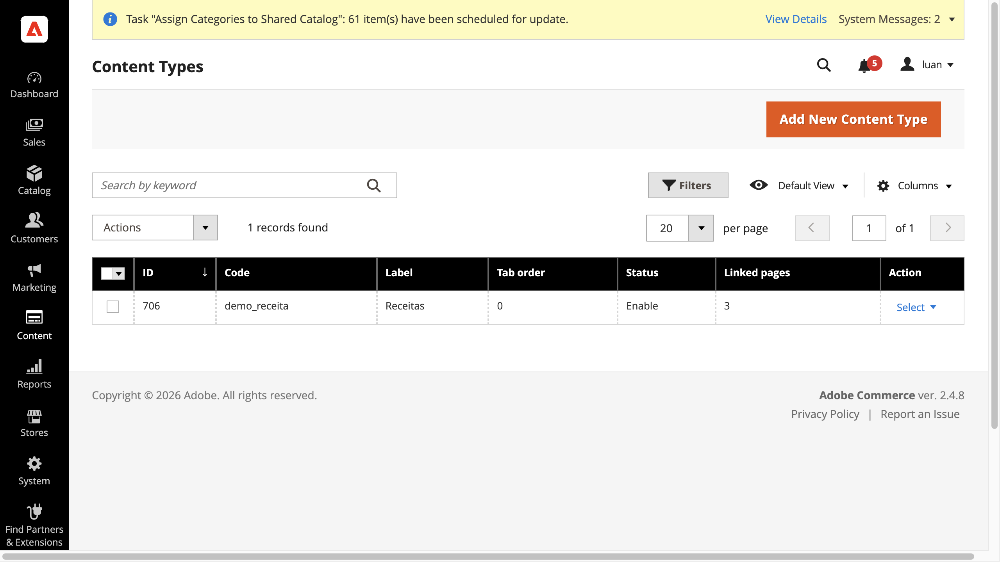
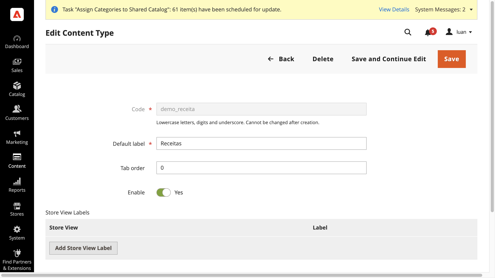
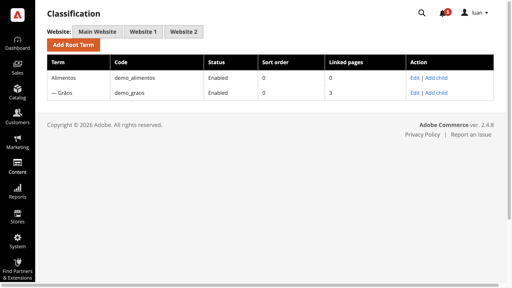
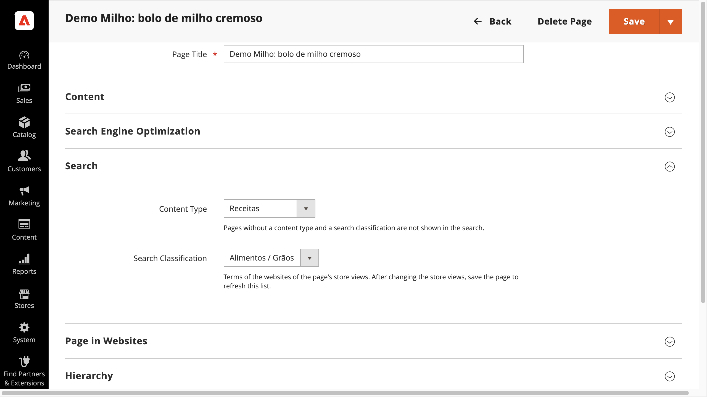
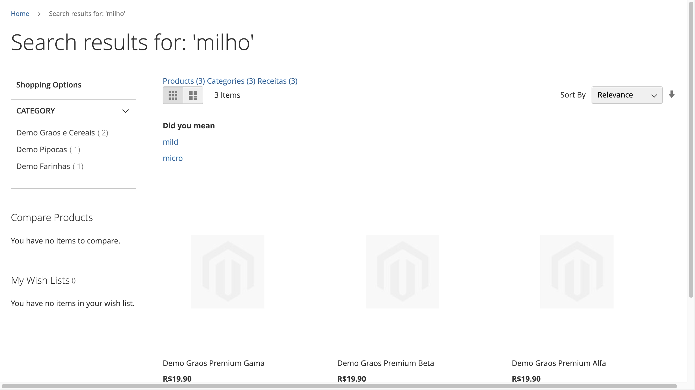
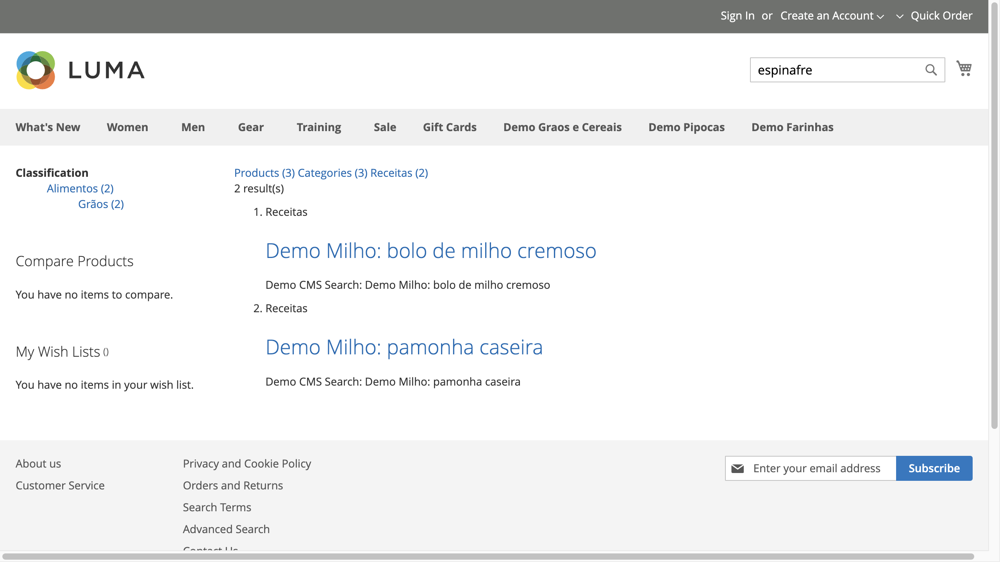
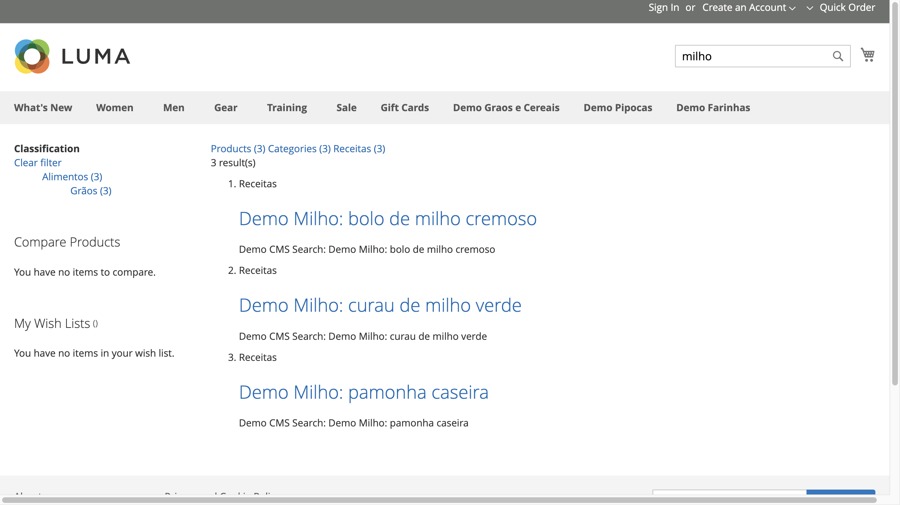

# Thedevkitchen_CmsSearch

CMS content search for the Adobe Commerce storefront. Shoppers who search the store see not only products but also the editorial content of the site (recipes, guides, articles...), organised in tabs.

## What it does

- **Tabs on the search results page** (`/catalogsearch/result/`): the native **Products** tab, a **Categories** tab, and one tab per editorial **content type** you define (for example "Receitas"). Every tab shows a counter.
- **Content types**: you create them in the admin ("Receitas", "Guides", ...) and give each one a label per store view.
- **Search classification**: a tree of terms per website (for example Alimentos > Grãos). Each CMS page gets one content type and one term, and the shopper can narrow a content tab down with a hierarchical filter.
- **Products tab stays native**: the module does not change how products are searched or ranked. It only adds the tab bar around the native page.
- **Categories tab**: category name and description are indexed and shown as cards.
- **Block text counts for the host page**: text from a CMS Block, a Dynamic Block or a widget placed on a CMS page, a product page or a category page is searchable on that host. Searching a word that exists only inside such a block finds the page, product or category that shows it.
- **Asynchronous indexing**: saving content in the admin never waits for the index. Each change publishes a message to RabbitMQ; a consumer reads the message and updates OpenSearch (one index per store view behind a stable alias). Changes become searchable a moment after the consumer processes them (eventual consistency, no SLA).

## Not covered in v1

- B2B shared catalogs, companies and customer-group visibility are not considered. Category documents follow what a guest visitor can see.
- Dynamic Blocks restricted by a customer segment, or linked to cart/catalog price rules, are not indexed.
- Widgets set to "All Pages" (footer, header, menu, generic link blocks) are not indexed on any host.
- CMS pages without a content type and a classification term are not indexed.
- Search results are not personalised; the results page must not be cached by the full-page cache without an invalidation strategy (see the technical reference).

## How to use

The examples use the demo data of this project (content type "Receitas", terms Alimentos > Grãos, CMS pages "Demo Milho"). Commands run from the repository root of the Warden project.

### Prerequisites

- OpenSearch and RabbitMQ are up (`warden env up`).
- The module is enabled and the schema is installed:

  ```
  warden env exec -T php-fpm bin/magento module:status Thedevkitchen_CmsSearch
  warden env exec -T php-fpm bin/magento setup:upgrade --keep-generated
  warden env exec -T php-fpm bin/magento cache:flush
  ```

  (`--keep-generated`: in developer mode never run `setup:di:compile`.)
- In the admin, Stores > Configuration > Thedevkitchen > CMS Search > "Show CMS Tabs" is "Yes" (default).

### Step 1: create a Content Type

Admin: **Content > CMS Search > Content Types**, then **Add New Content Type**.



Fill in the **Code** (lowercase letters, digits and underscore; cannot be changed later), the **Default label** (the tab name), **Tab order** and **Enable**. Optionally use **Add Store View Label** to translate the tab name per store view.



### Step 2: create classification terms

Admin: **Content > CMS Search > Classification**. Pick the website, then **Add Root Term** and, on a term, **Add child**. Terms have a code, a default label (plus optional store view labels), a sort order and an active flag. There is one tree per website.



### Step 3: set type and term on a CMS page

Admin: **Content > Elements > Pages**, edit a page, open the **Search** section and choose **Content Type** and **Search Classification** (both or none), then save. A page without both values is not indexed.



### Step 4 (optional): add a block to the page

Put a CMS Block or a Dynamic Block in the page content (for example with the widget directive in the editor), or place a widget instance on the page, a product or a category. Its text becomes searchable on the host page. See "Not covered in v1" for the exceptions.

### Step 5: index

Nothing is indexed during the admin save: messages wait in the RabbitMQ queue until a consumer runs. On this Warden project the php-fpm container has no cron, so start the consumer by hand.

1. Make sure no consumer is running, then rebuild the page and category index of every store view (first fill, or after a mapping change):

   ```
   warden env exec -T php-fpm bin/magento thedevkitchen:cmssearch:reindex --sync
   ```

   Run `--sync` with consumers stopped: messages processed while it runs are applied to the old index and lost at the switch.
2. Ask for the product pages (block text goes into the native product index):

   ```
   warden env exec -T php-fpm bin/magento thedevkitchen:cmssearch:reindex --entity=product
   ```

   `--entity=page|category|product|all` and `--store=ID` limit what is published.
3. Start the consumer so the queued messages are processed. `--max-messages=N` stops it after N messages; without it, it waits for new ones until you stop it (Ctrl+C):

   ```
   warden env exec -T php-fpm bin/magento queue:consumers:start thedevkitchen.cmssearch.reindex --max-messages=100
   ```

4. Check the queue is empty (0 messages; the dead-letter queue `...dlq` must stay 0):

   ```
   warden env exec -T rabbitmq rabbitmqctl list_queues name messages consumers | grep thedevkitchen.cmssearch
   ```

In production the Magento cron (`consumers_runner`) starts the consumer for you.

### Step 6: search on the storefront

Open `https://app.adobecommerce.test/catalogsearch/result/?q=milho`. You see the tab bar with a counter per tab (Products, Categories, Receitas).



Open the content tab (here "Receitas"): result cards for the matching pages and, on the left, the **Classification** filter with the terms and how many results each holds (Alimentos > Grãos). Searching `espinafre` finds only pages that show a block containing that word.



Click a term to narrow the results; **Clear filter** removes it.



### Step 7: run the automated tests

Run them one at a time, never at the same time (they share the admin, the database and the broker). The "opt-in" suites skip unless you set the variable; they need the Warden containers up, clean up after themselves and stop if a consumer is running.

| What | Command (repository root) |
|------|---------------------------|
| Unit tests (PHPUnit) | `php vendor/bin/phpunit -c phpunit.xml` |
| ACL and data rules | `bash integration/test_content_type_acl.sh` and `bash integration/test_classification.sh` |
| Reindex queue (RabbitMQ) | `CMSSEARCH_QUEUE_SUITE=1 bash integration/test_cms_search_queue.sh` |
| CMS page index (OpenSearch) | `CMSSEARCH_INDEX_SUITE=1 bash integration/test_cms_search_index.sh` |
| Blocks and enrichment | `CMSSEARCH_REFERENCES_SUITE=1 bash integration/test_cms_search_references.sh` |
| Search results page | `CMSSEARCH_UI_SUITE=1 bash integration/test_cms_search_ui.sh` |
| Full-page cache / Varnish | `CMSSEARCH_CACHE_SUITE=1 bash integration/test_cms_search_cache.sh` |
| Admin screens (Cypress) | `cd e2e && env -u ELECTRON_RUN_AS_NODE npx cypress run --spec cypress/e2e/content-type-admin.cy.js` (also `classification-admin.cy.js`, `cms-page-search-fieldset.cy.js`) |
| Storefront (Cypress) | `node e2e/cypress/support/hostmap-proxy.js &` then `cd e2e && HTTPS_PROXY=http://127.0.0.1:18443 NO_PROXY= env -u ELECTRON_RUN_AS_NODE npx cypress run --spec cypress/e2e/cms-search-storefront.cy.js` |

If the main queue already holds messages, the suites that purge queues refuse to start; set `CMSSEARCH_QUEUE_PURGE_OK=1` to allow it and run `thedevkitchen:cmssearch:reindex --entity=page` afterwards. The screenshots above come from `e2e/cypress/e2e/cms-search-docs-screenshots.cy.js` (copy step: `e2e/cypress/support/copy-docs-screenshots.sh`).

## Documentation

- Demo data and Cypress evidence screenshots (searches for "milho" and "espinafre", admin screens): [docs/evidence/cms-search-demo/](../../../../docs/evidence/cms-search-demo/README.md).

How it is built, decisions, runbook, known limits and release notes: [TECHNICAL-REFERENCE.md](TECHNICAL-REFERENCE.md).
